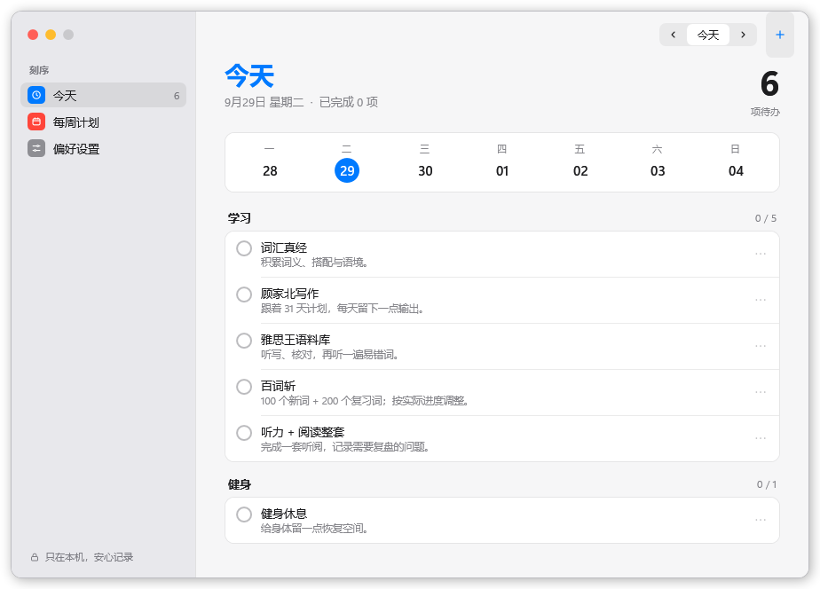

# Kora Desk

[简体中文](README.md) · English


**A minimal, offline Windows task widget with a separate planner.**

Keep today's checklist on your desktop. Plan recurring routines in a separate window, then close it and get on with your day. Kora Desk ships with **five interface styles**, each in light and dark: macOS, Windows 11 Fluent, Material 3 Expressive, IBM Carbon and a dot-matrix instrument look. Pick one in Preferences; the planner and the widget change together.

[Download for Windows](https://github.com/Cennyk-learner/kora-desk/releases/latest) · [Report an issue](https://github.com/Cennyk-learner/kora-desk/issues)

## Styles

| Style | What it looks like |
|---|---|
| **macOS** (default) | Tinted sidebar with colored icons, round check boxes, a large title with the open-task count, grouped rounded lists. Light card widget. |
| **Fluent · Mica** | Windows 11 language: Mica base, rounded content layer, navigation pane with Preferences pinned to the bottom, a progress ring. |
| **Material 3 Expressive** | Heavy headline, wavy progress, cookie-shaped badge, week buttons that become pills, segmented list. |
| **IBM Carbon** | Header and side navigation, three data tiles, tasks as a table, square corners, dense. |
| **Dot matrix** | Dot-font numerals, one row of dots for progress, a single red signal color, dotted rules. Black widget. |

Appearance can follow Windows, or be fixed to light or dark. On Windows, `scripts\preview.ps1` renders every style and appearance (three planner pages and the widget) to `dist\previews`.

## Preview



[View all five styles, both appearances, and their widgets →](docs/THEMES.md)

## Get started

1. Download the Windows x64 ZIP from Releases and extract the entire archive.
2. Run `Kora.exe` to open the planner and desktop widget.
3. Check tasks off directly on the widget. Closing the planner leaves the widget running.

Requires Windows 10/11 x64 and .NET Framework 4.8 or later. Keep the two executables, shared DLL, configuration files, icon and the `fonts` folder together. The release is portable and currently unsigned; SHA-256 checksums are provided.

## Small surface, useful details

- **Five interface styles**, light or dark, following Windows if you like.
- **Desktop layer by default**, with an optional always-on-top mode.
- **Independent processes** for the planner and widget. Run `Kora.Widget.exe` on its own if preferred.
- Editable **weekly routines** and **one-off dated tasks**.
- Date-specific checkoffs, with daily progress and week navigation.
- Study, fitness, and life groups; optional task notes.
- Drag the widget header to reposition it. Long lists scroll.
- System tray controls to open the planner, show/hide the widget, change its mode, or quit.
- Local JSON backups, import/export, and automatic recovery from the previous valid save.

The current interface is in Simplified Chinese. The editable example schedule combines daily IELTS study with weekly listening/reading practice and a fitness routine. No textbook content is distributed.

## Private by design

The application makes no network requests and has no account system, telemetry, ads, or cloud synchronization. Data is stored in `%LOCALAPPDATA%\KoraDesk\plan.json`; the preceding save is kept in `plan.json.bak`. Writes are serialized across processes and committed using atomic file replacement.

Changing a recurrence rule changes which tasks are shown for past dates too. Completion records retain task IDs and dates, but historical versions of task names and rules are not stored. Export a backup before major plan changes.

## Compatibility notes

Desktop mode keeps a native top-level window above Explorer's desktop and below ordinary apps. Switching modes no longer reparents the transparent WPF window. Explorer detection still depends on its window structure, so alternative shells, desktop customization tools, Show Desktop behavior, and future Windows versions require compatibility testing. Use always-on-top mode when desktop ordering is unavailable.

Show Widget wakes the existing process. First launch of a downloaded unsigned executable may still show a Windows security prompt; Kora does not dismiss or disable these prompts.

Reminders, a Pomodoro timer, automatic startup registration, cloud synchronization, and other platforms are not included in this release.

## Build

On Windows, using the .NET Framework compiler already present on the system:

```powershell
powershell -NoProfile -ExecutionPolicy Bypass -File .\scripts\build.ps1 -Test
```

No NuGet packages or browser runtime are required. Binaries are generated in `dist/`. See [development notes](docs/DEVELOPMENT.md) for architecture and verification.

If Kora Desk makes your desktop a little calmer, a **Star** helps others discover it.

[MIT License](LICENSE)
