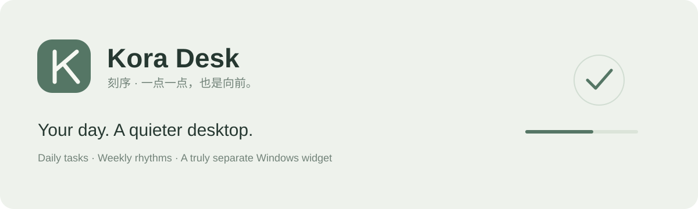

# Kora Desk

[简体中文](README.md) · English

A quiet Windows desktop planner for students: a small widget for today's checklist, a planner window for the weekly routine, a focus timer, and gentle motivation that does not shame you. Local only, no account, no network.

Kora Desk 2.0 is a single-file, single-process app built with Tauri 2 (Rust + Svelte). The exe is about 3–4 MB and needs no installer.

## Quick start

1. Download `Kora.exe` from [Releases](https://github.com/Cennyk-learner/kora-desk/releases/latest), or build it ([DEVELOPMENT.md](docs/DEVELOPMENT.md)).
2. Run it. Closing the planner leaves it in the tray; the widget keeps running.
3. Requires Windows 10/11 x64 and the Edge WebView2 runtime (built into Windows 11).

Upgrading from 1.x: just run it. `plan.json` is upgraded in place and the original is kept as `plan.json.v1.bak`.

## Features

- **Daily checklist** with weekly or one-off tasks, groups, estimates, and a desktop widget. Five skins (macOS, Fluent, Material 3, IBM Carbon, dot-matrix), each light and dark.
- **Positive feedback**: tick animation, smooth progress, confetti, a rising combo scale, a day-complete celebration. Sounds are synthesised; mute, volume and reduced motion are respected.
- **Daily quote** (420+, shuffle bag: no repeats within a pass) and **daily word**, with favourites.
- **Pomodoro**: choose durations, task, auto-check, noise, strict mode on the focus page before you start (remembered). Full-screen focus (Esc to leave) and sleep prevention keep the screen awake. Restart-safe, widget mini timer, tray countdown, notifications, global shortcuts.
- **Give-up bank, automatic**: there is no give-up button. When you open the app the next day, every task left undone the day before is recorded (0.1 day each), with a one-year projection, monthly chart and optional reasons.
- **Leave**: mark a day as leave with a reason. Leave days are not counted and do not break streaks; they are summarised on the give-up page, and 3 or more leave days in a week raises a warning.
- **Progress**: streaks with freeze cards, heatmap, completion trends, focus history, estimate vs. actual, XP levels, 12 achievements, weekly summary image, CSV export.
- **Study tools**: exam countdown with suggested daily amount, daily commitment and evening review, spaced-review tasks (1/2/4/7/15 days).
- **Take care**: mood, three small joys, water, breathing exercises, rewards; eye-care, sitting and bedtime reminders; autostart.

## Data

`%LOCALAPPDATA%\KoraDesk\plan.json` (override with `KORA_DATA_DIR`). The previous save is kept as `plan.json.bak`; a damaged file is restored from it automatically. No telemetry.

MIT licensed.
