# 界面预览 / Theme gallery

以下均为 v1.1.0 在 Windows 上的实际渲染。点击图片可以查看原图。偏好设置中的「界面风格」和「外观」会同时应用到管理窗口与桌面组件。

These are actual Windows renders of v1.1.0. Choose a style and appearance in Preferences to update both windows.

## mac

| 浅色 / Light | 深色 / Dark |
|---|---|
|  | 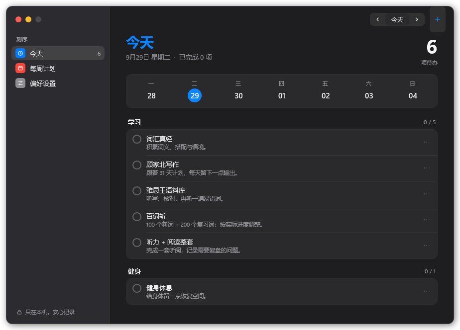 |
| 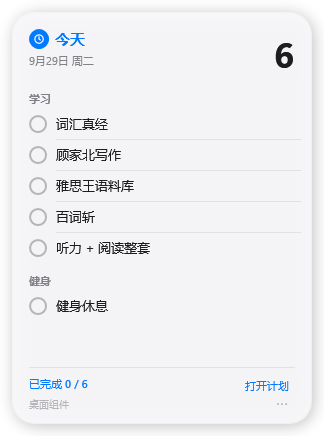 | 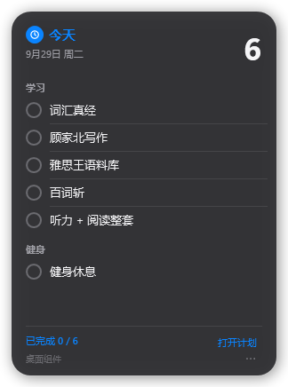 |

## fluent

| 浅色 / Light | 深色 / Dark |
|---|---|
| 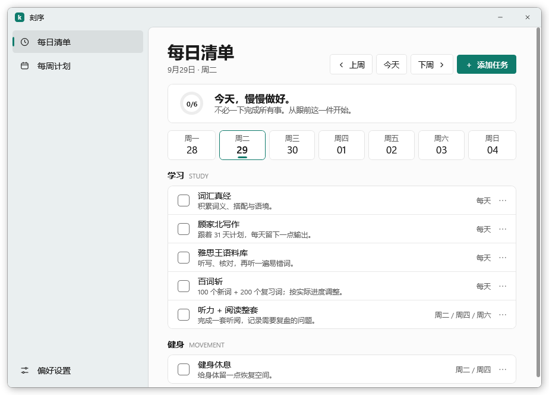 | 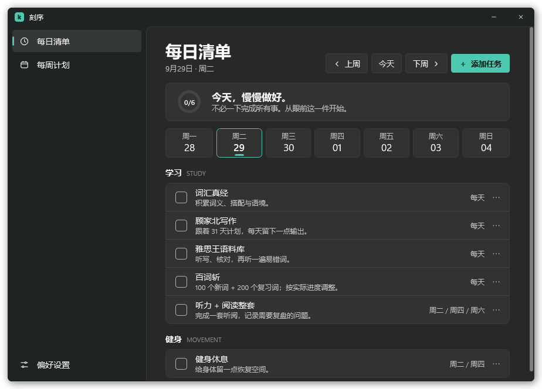 |
| 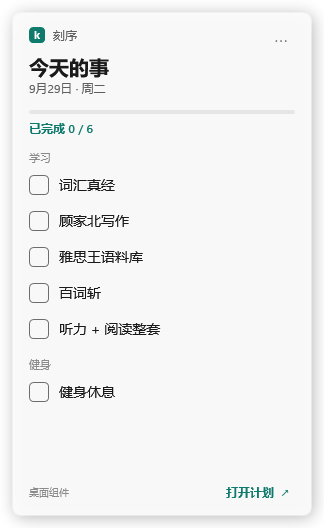 | 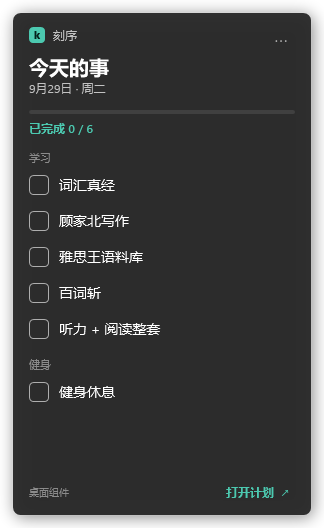 |

## material

| 浅色 / Light | 深色 / Dark |
|---|---|
| 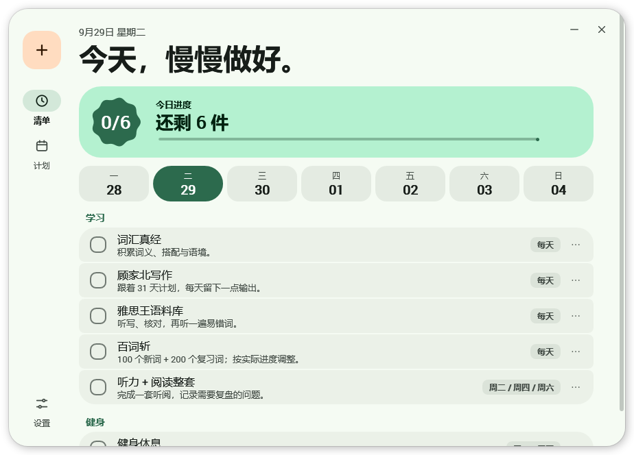 | 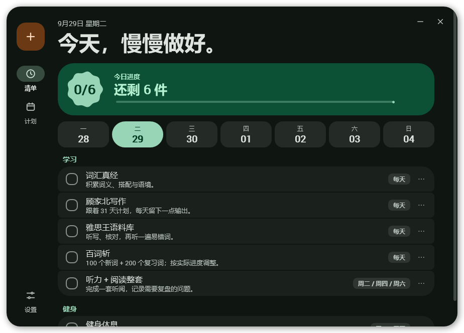 |
| 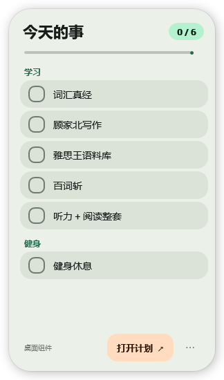 | 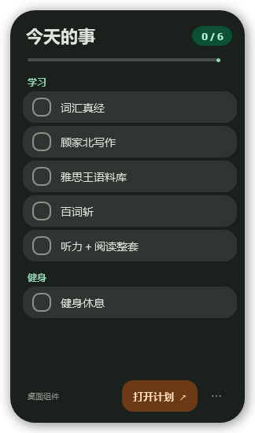 |

## carbon

| 浅色 / Light | 深色 / Dark |
|---|---|
| 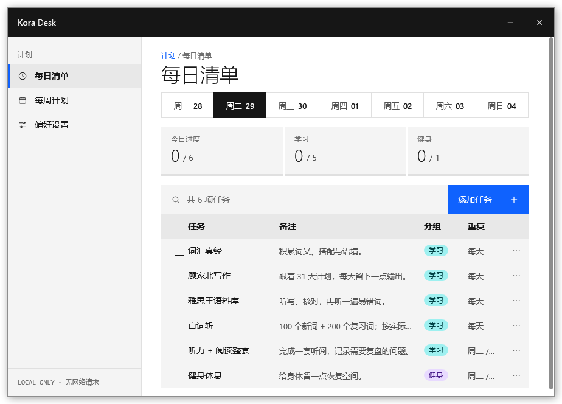 | 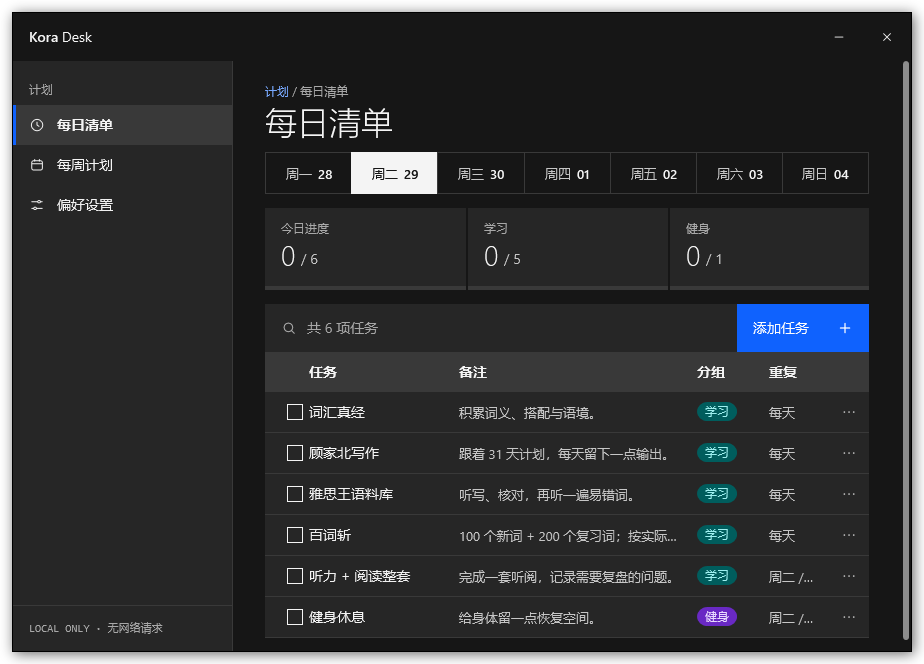 |
| 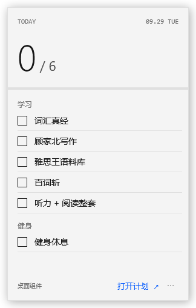 | 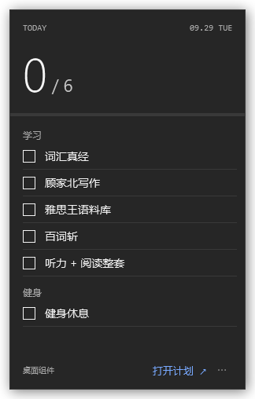 |

## dot

| 浅色 / Light | 深色 / Dark |
|---|---|
| 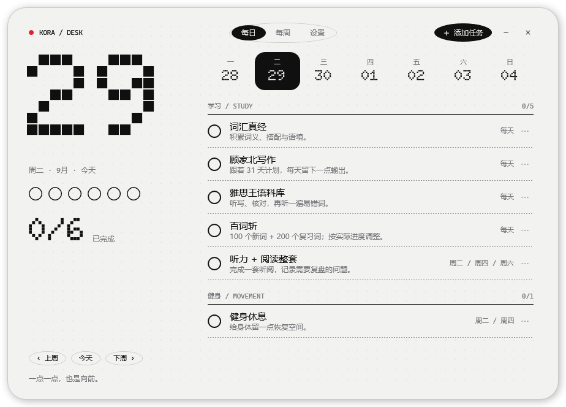 | 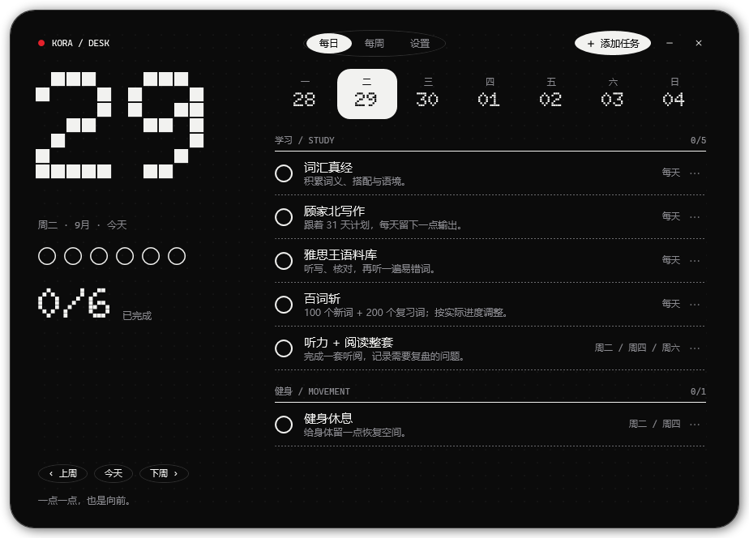 |
| 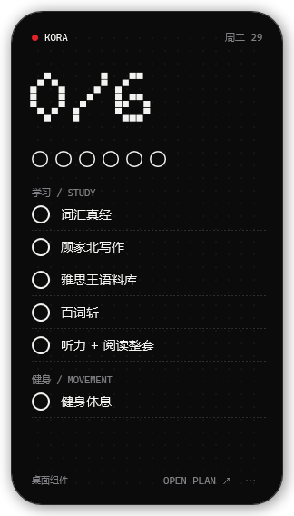 |  |
